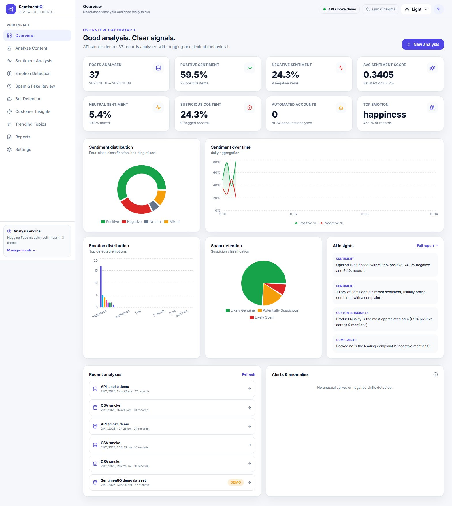
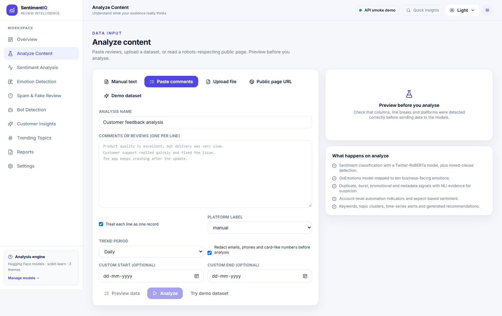
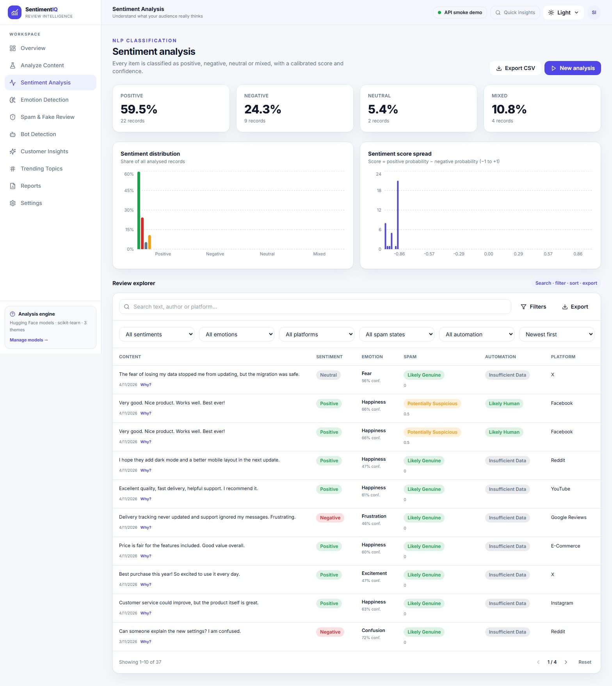
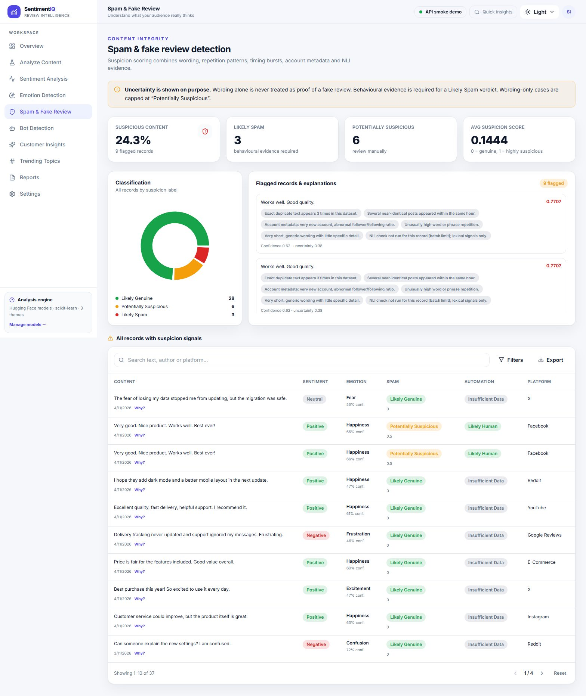
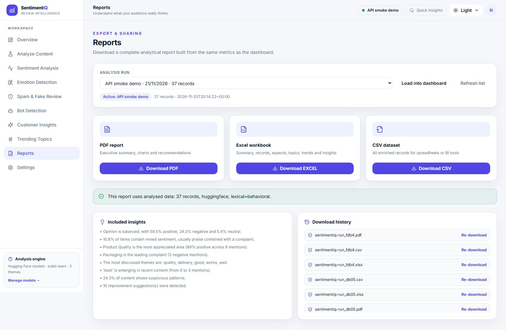
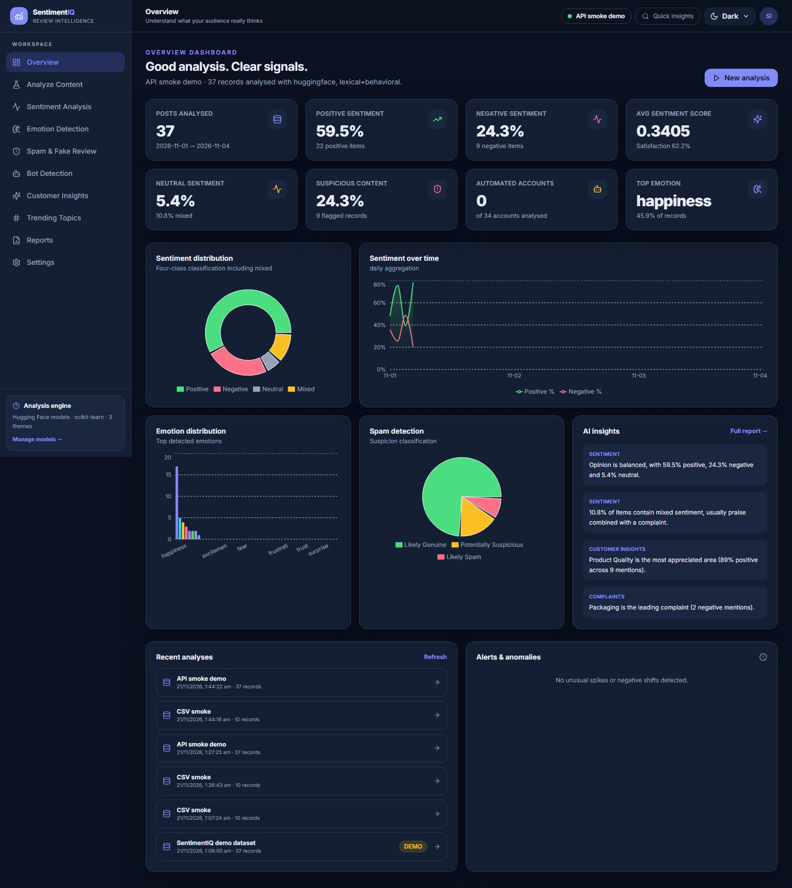
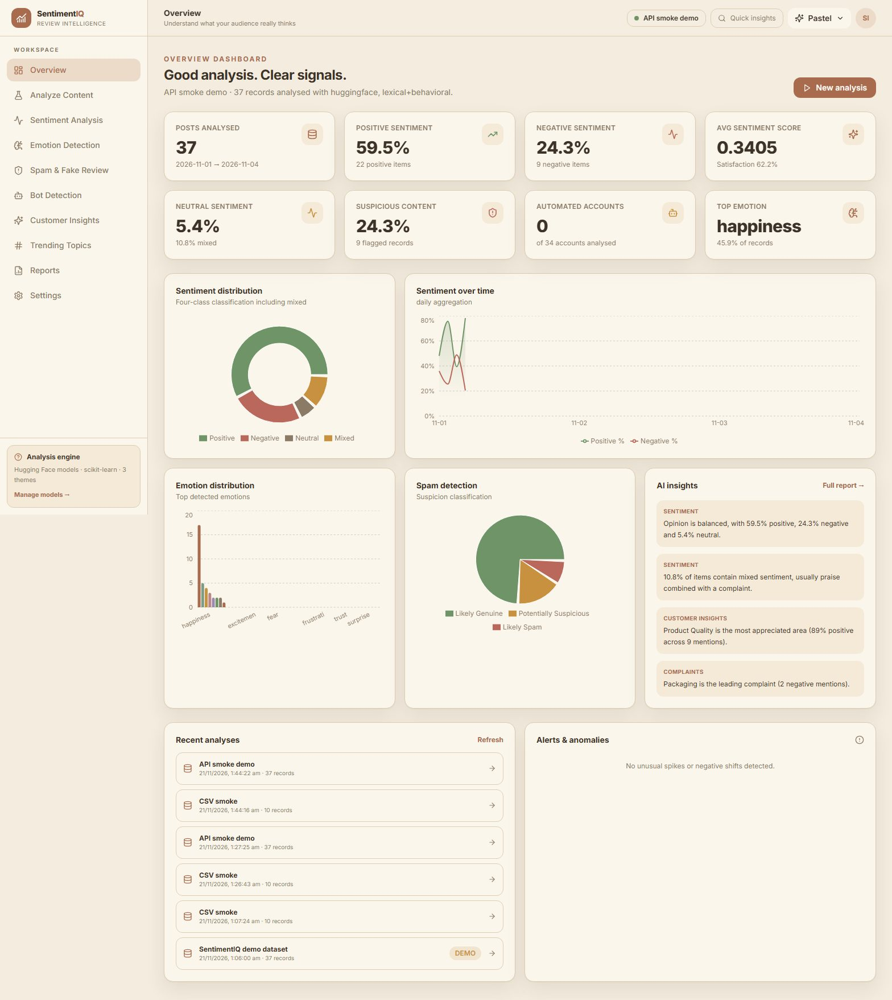

# SentimentIQ

AI-powered social media & customer-review intelligence platform.

A full-stack React + FastAPI application that analyses pasted comments, uploaded CSV/Excel/TXT datasets and robots-respecting public web pages. It produces sentiment, emotion, suspicion, automation, aspect, topic and trend intelligence — then exports PDF, Excel and CSV reports.

## Highlights

- **Real NLP, not random results.** Hugging Face transformers for sentiment (`cardiffnlp/twitter-roberta-base-sentiment-latest`), emotion (`SamLowe/roberta-base-go_emotions`) and zero-shot evidence (`typeform/distilbert-base-uncased-mnli`). scikit-learn TF-IDF/NMF for topics and similarity.
- **Three themes.** Light, Dark and **Pastel sepia** (the balanced middle mode), switchable from the top bar or Settings.
- **Honest trust & safety.** Wording alone never produces a “Likely Spam” verdict. Behavioural evidence, metadata, repetition, bursts and uncertainty are shown. Bot detection needs multiple independent indicators.
- **Preview before analysis.** Line/file/URL ingestion with column detection, warnings, PII redaction and a data preview table.
- **Interactive dashboard.** KPI cards, pie/donut/bar/area/line charts, word cloud, filters, review explorer, alerts and generated recommendations.
- **Report generation.** PDF (with charts), multi-sheet Excel and enriched CSV.
- **Built for large datasets.** Uploads are staged to JSONL, inference runs in bounded chunks, records are paginated from the server, and CSV/Excel exports stream from disk. A 100,000-row end-to-end scale test is included.
- **Optional multi-user auth.** Individual accounts with PBKDF2 password hashes, admin/analyst/viewer roles, self-service password changes and short-lived HMAC JWTs. Disabled by default so the local demo works immediately.

## Screenshots

Captured from the labelled API demo run (37 records), so all charts below reflect real analysis output rather than invented numbers.

| Overview dashboard | Analyze / preview before ingestion |
|---|---|
| [](docs/screenshots/01-overview-light.jpg) | [](docs/screenshots/02-analyze.jpg) |

| Sentiment intelligence | Spam & fake-review evidence |
|---|---|
| [](docs/screenshots/03-sentiment.jpg) | [](docs/screenshots/04-spam.jpg) |

| Reports | Dark theme |
|---|---|
| [](docs/screenshots/05-reports.jpg) | [](docs/screenshots/06-overview-dark.jpg) |

Pastel Sepia theme:

[](docs/screenshots/07-overview-pastel.jpg)

## Project structure

```
sentimentiq/
├─ backend/
│  ├─ app/
│  │  ├─ analysis/       # modular sentiment, emotion, spam, bot, aspects, topics, trends, insights
│  │  ├─ main.py         # FastAPI routes
│  │  ├─ models.py       # lazy HF model manager + cache
│  │  ├─ ingestion.py    # text/file/URL parsing + SSRF & robots protection
│  │  ├─ store.py        # staged JSONL datasets, run records, pagination, export
│  │  ├─ reports.py      # PDF / Excel / CSV export
│  │  └─ ...
│  └─ requirements.txt
└─ frontend/
   ├─ src/pages/         # 10 SaaS-style pages
   ├─ src/components/    # layout, charts, records table, UI primitives
   └─ package.json
```

## Quick start

### 1. Backend

```powershell
cd sentimentiq\backend
python -m venv .venv
.\.venv\Scripts\Activate.ps1
pip install -r requirements.txt
uvicorn app.main:app --reload --port 8000
```

API docs: <http://127.0.0.1:8000/docs>

### 2. Frontend

```powershell
cd sentimentiq\frontend
npm install
npm run dev
```

Dashboard: <http://localhost:5173>

The Vite dev server proxies `/api` to `http://127.0.0.1:8000`.

### Production-style single server

```powershell
cd sentimentiq\frontend
npm run build
cd ..\backend
uvicorn app.main:app --host 0.0.0.0 --port 8000
```

The built SPA is then served from the same FastAPI process.

## Large datasets

Large uploads never travel through the browser as one JSON document:

1. `POST /api/ingest/preview` streams the file into `backend/data/datasets/*.jsonl` and returns only a 10-row preview plus metadata. For inputs of up to 500 records it also returns inline records for backwards compatibility.
2. `POST /api/analyze` accepts the returned `dataset_id`. The analysis job streams rows from disk, computes global duplicate/burst/account signals in bounded passes, and writes enriched rows to `backend/data/runs/*.jsonl`.
3. The UI reads records through `GET /api/runs/{id}/records?offset=…&limit=…` with server-side filtering and sorting. LocalStorage keeps only the active run id.
4. CSV and Excel exports stream the run JSONL. PDF stays bounded to summaries and samples.

Defaults: 200 MB files, 250,000 staged rows, 500 inline records, and 100,000 analysed rows per run. If a staged dataset exceeds the analysis limit, the run is truncated and the UI/report includes an explicit notice. Tune with `SENTIMENTIQ_MAX_FILE_MB`, `SENTIMENTIQ_MAX_RECORDS`, `SENTIMENTIQ_INLINE_RECORDS`, `SENTIMENTIQ_ANALYZE_LIMIT`, `SENTIMENTIQ_INFERENCE_CHUNK` and `SENTIMENTIQ_SORT_CHUNK_SIZE`.

Run the scale test (transformer inference is stubbed so it finishes in seconds):

```powershell
python smoke_large.py
```

It stages and analyses 100,000 rows, then verifies paginated filtering, sorted paging, 100,001-line CSV export and bounded PDF output.

Run the multi-user auth test (uses a temporary SQLite database, so it never touches your accounts):

```powershell
python smoke_auth.py
```

It verifies login, account creation, role permissions, self-service password changes, admin resets, disable/enable, and last-admin protections.

## Downloading the models

Models download on first use, or from **Settings → AI models → Download all models**. They are cached in `backend/data/models`. The Settings page shows cached/loaded/error state for each checkpoint. If a download fails, analysis continues with a transparent lexicon/behavioral fallback and labels the engine used.

> First download is several hundred MB and needs internet access. CPU inference is the default; set `SENTIMENTIQ_DEVICE=0` to use the first CUDA GPU.

## Enabling multi-user authentication

Copy `.env.example` and set at least:

```text
SENTIMENTIQ_AUTH_ENABLED=true
SENTIMENTIQ_ADMIN_PASSWORD=a-strong-password
SENTIMENTIQ_SECRET_KEY=a-long-random-string
```

Export these before starting uvicorn (or load them with your env-file tool). `SENTIMENTIQ_ADMIN_PASSWORD` seeds the **first** admin account only; it is stored as a salted PBKDF2 hash in the local SQLite database, not in plain text.

Once signed in, use **Settings → Users & access** to:

- create additional `admin`, `analyst` or `viewer` accounts;
- change your own password;
- reset another account's password;
- disable, enable, reassign or delete accounts.

`viewer` accounts can browse results but cannot start analyses or delete runs. `analyst` accounts can work with data but cannot manage accounts. The last active admin cannot be demoted, disabled or deleted. If no seeded admin is configured and the database is empty, the login screen offers a one-time **Create the first admin** option.

## Input formats

| Method | Notes |
| --- | --- |
| Manual text | Single or multiple records, with a platform label. |
| Paste comments | One record per line (or split on blank lines). |
| CSV / Excel / TXT | Recognised columns: `text`, `content`, `comment`, `review`, `post`, `message`, `body` plus `platform`, `author`, `timestamp`, `id`, and optional `likes`, `replies`, `followers`, `following`, `account_age_days`, `posts_per_day`, `verified`. |
| Public URL | Domain allowlist, robots.txt check, private-IP blocking, size/time limits. No login bypass or private API access. |
| Demo dataset | Hand-written 37-record dataset, clearly marked `DEMO` in the UI and reports. |

Emails, phone numbers and card-like sequences are redacted by default before model inference and storage.

## Dataset foundation

| Dataset | Role in this build |
| --- | --- |
| TweetEval – Sentiment | Model family for social-text sentiment classification. |
| GoEmotions – Emotion | Model family for the ten business-facing emotion categories. |
| Yelp Open Dataset | Customer-review domain reference for aspect vocabulary. |
| YelpChi | Behavioural signal design for duplicate/repetition suspicion (no trust labels are assumed). |
| TwiBot-22 | Behavioural signal design for automation indicators (no account is auto-labelled a bot). |

The datasets inform model/signal choices; the app does not ship copied proprietary rows.

## Honest limitations

- URL ingestion reads public, robots-permitted HTML text blocks. It is not a replacement for official platform APIs; authenticated or rate-limited content is not accessed.
- Sentiment “Mixed” is inferred from contrast clauses, not from a dedicated four-class model.
- Suspicion and automation scores are decision support, not proof. Reports always show confidence, uncertainty and the underlying indicators.
- No live LLM text generation is used for insights; the insight engine writes sentences from the exact computed metrics, which keeps numbers reproducible.

## GitHub and VS Code

The repository is published at **https://github.com/SashaKolhatkar/sentimentiq**.

To work with it in VS Code:

1. Clone the URL above: `git clone https://github.com/SashaKolhatkar/sentimentiq.git`.
2. Open the folder in VS Code. The Source Control panel shows changes, and the **Publish to GitHub** button can also create a fork if you want your own copy.
3. Commit with a message such as `Update SentimentIQ`, then **Sync Changes** (`Ctrl+Shift+P → Git: Sync`).
4. The included `.github/workflows/ci.yml` builds the frontend and compiles the backend on every push.

## Deployment

The project includes a production `Dockerfile` that builds the Vite SPA and serves it from FastAPI. It respects the `PORT` environment variable and defaults to `8000`, so it works on ordinary container hosts.

### Cloudflare quick tunnel (no payment, recommended for this machine)

Hugging Face Spaces now requires a paid plan for Docker, and Render’s free container has only 0.1 CPU / 512 MB RAM, which is too small for the transformer models. The reliable no-payment option is to run the already-installed app on your own machine and expose it through a free Cloudflare quick tunnel. Your local model cache and SQLite history stay intact.

1. Install the tunnel client once:

   ```powershell
   winget install --id Cloudflare.cloudflared
   ```

2. From the project root, run:

   ```powershell
   powershell -ExecutionPolicy Bypass -File .\deploy_cloudflare.ps1
   ```

3. The script starts the backend on port `8011`, enables authentication, generates the first admin password, and prints a public `https://*.trycloudflare.com` URL. Keep the window open while sharing the link. Press `Ctrl+C` to stop both the tunnel and backend.

The quick-tunnel URL changes every time you restart it. If you need a stable always-on public URL, use a paid/always-on host or an Oracle Cloud Always Free VM (free of charge, but signup requires card verification).

### GitHub Actions to a free Linux VM (recommended for always-on free hosting)

The included `.github/workflows/deploy.yml` rebuilds and redeploys the app over SSH on every push to `main` (and can also be run manually from the Actions tab). The workflow uses GitHub-hosted runners and never stores your VM key in the repository.

An Oracle Cloud **Always Free** Ubuntu ARM VM is the recommended target: it has enough RAM for the transformer models, unlike the Render/Railway free plans. Oracle signup is free but asks for card verification. The workflow also works with any Linux VM that has Docker, Docker Compose and Git installed.

Oracle-specific setup:

1. In the Oracle Cloud console, create an **Instance** with **Ubuntu 24.04** and the **VM.Standard.A1.Flex** shape. Set 4 OCPUs / 24 GB RAM (still Always Free) and a 50 GB boot volume. If A1 capacity is temporarily unavailable, retry later rather than choosing the 1 GB E2.1.Micro shape, which cannot run the models.
2. Generate a dedicated deploy key on your computer:

   ```powershell
   ssh-keygen -t ed25519 -C "sentimentiq-deploy" -f "$env:USERPROFILE\.ssh\sentimentiq_deploy"
   Get-Content "$env:USERPROFILE\.ssh\sentimentiq_deploy.pub"
   ```

   Paste the `.pub` output as the instance’s SSH public key. The private key (the file without `.pub`) becomes the `DEPLOY_SSH_KEY` repository secret.
3. Note the instance’s public IP. Add an ingress rule for TCP `8000` in the VCN security list (or your chosen `DEPLOY_PORT`).
4. SSH in as `ubuntu` and run the one-time setup below.

One-time VM setup:

```bash
sudo apt-get update
sudo apt-get install -y docker.io docker-compose-plugin git curl
sudo usermod -aG docker "$USER"
newgrp docker
mkdir -p /opt/sentimentiq
git clone https://github.com/SashaKolhatkar/sentimentiq.git /opt/sentimentiq
```

Open your VM’s `PORT` (default `8000`) in its firewall/network security rules.

Then add these secrets under **GitHub repository → Settings → Secrets and variables → Actions → New repository secret**:

| Secret | Value |
| --- | --- |
| `DEPLOY_HOST` | Public IP or DNS name of the VM |
| `DEPLOY_USER` | SSH user (for Oracle Ubuntu images this is usually `ubuntu`) |
| `DEPLOY_SSH_KEY` | Contents of the private SSH key authorized on the VM |
| `DEPLOY_PATH` | Clone path, e.g. `/opt/sentimentiq` |
| `DEPLOY_SSH_PORT` | SSH port, optional (defaults to `22`) |
| `DEPLOY_PORT` | App port, optional (defaults to `8000`) |
| `PUBLIC_ORIGIN` | `http://VM_IP:8000` or your HTTPS domain |
| `SENTIMENTIQ_ADMIN_USER` | First admin username, optional (defaults to `admin`) |
| `SENTIMENTIQ_ADMIN_PASSWORD` | Strong first-admin password |
| `SENTIMENTIQ_SECRET_KEY` | Long random signing secret |

Generate the last two values locally, for example:

```powershell
[Convert]::ToBase64String((1..32 | ForEach-Object { Get-Random -Max 256 }) -as [byte[]])
```

After the secrets are added, push to `main` or run the **Deploy to free Linux host** workflow manually. The workflow writes a server-only `.env`, pulls the repo, rebuilds the Compose image, starts it, and waits for `/api/health`. Logs are printed automatically if the health check fails.

> `SENTIMENTIQ_ADMIN_PASSWORD` seeds only the first account. After the first deployment, change passwords and add accounts in **Settings → Users & access**. The SQLite database and downloaded models live in the `sentimentiq-data` Docker volume, so they survive redeploys.

### Container hosts (optional)

The Dockerfile runs as UID 1000 with a writable `/app/backend/data` directory and works on Render, Railway, Fly.io or any Docker host. `render.yaml` uses the free Render plan without a paid disk, but its 512 MB RAM is below what the four Hugging Face models need, so it is not recommended for full analysis jobs.

For any public deployment, always set:

```text
SENTIMENTIQ_AUTH_ENABLED=true
SENTIMENTIQ_ADMIN_PASSWORD=<strong-password-for-first-admin-only>
SENTIMENTIQ_SECRET_KEY=<long-random-secret>
SENTIMENTIQ_CORS_ORIGINS=https://your-public-domain
```

## Troubleshooting

- **Charts empty:** run an analysis first, or click “Try demo dataset”.
- **Models downloading:** check Settings, or call `POST /api/models/warm`.
- **CORS error:** make sure `SENTIMENTIQ_CORS_ORIGINS` includes your frontend origin.
- **No timeline:** add a `timestamp`/`date` column; the app never invents dates.
